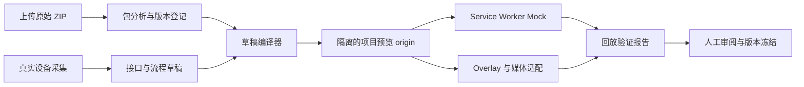

# AI 模拟器工作台下一阶段实施计划

## 1. 目标

当前 MVP 已能在线创建设备项目、上传静态包、连接获准的真实设备、人工浏览并采集接口，生成可下载的 Mock 草稿。下一阶段要把这份草稿接入 `web-simulator`，让管理员可以在隔离预览环境运行设备包、检查 Mock 与 Overlay 效果，并在验证通过后保存为待发布版本。

本阶段的交付目标是“可运行、可检查的模拟器草稿”。生产考试端发布、自动回滚和大规模 Worker 调度不纳入本阶段；对外开放前必须先满足第 8 节的安全门槛。

## 2. 当前代码基线与差距

- 管理端位于 `web-admin/src/views/AiWorkbenchView.vue`，已有项目、ZIP 上传、远程浏览会话、请求审批、Mock 草稿预览与下载。
- Java API 已保存项目、静态包和会话元数据；ZIP 目前保存在本地数据目录，没有构建或部署到 Simulator 的导入流程。
- Worker 使用 Playwright 采集流量。现有 Mock 草稿主要记录方法、路径、状态码、查询键、是否有请求体和脱敏响应样例，尚不能表达完整请求匹配条件、状态变化或流程步骤。
- Simulator 当前在 `RuntimeView.vue` 中硬编码 `/device-demo/index.html`，Service Worker 注册到 `/device-demo/`，并通过同源 iframe 注入 `sim-bridge.js`。这适用于仓库内的演示设备包，不能直接作为上传包的多项目运行时。
- `sim-bridge.js` 直接访问 iframe DOM 和设备页全局对象。将未知设备包放在相同 origin 会扩大包内脚本对 Simulator 壳的访问能力；不能将所有上传包直接放到共享 Simulator origin。
- 生产 Compose 的管理鉴权、用户/项目 RBAC、Worker 出站网络限制、对象存储和项目级域名隔离仍未完成。

## 3. 本阶段建议交付范围

### 纳入

1. 将上传包登记为不可变 `PackageVersion`，保留原始 ZIP、SHA-256、文件清单和分析结果。
2. 定义有版本号的 `SimulatorDraft` JSON schema，将 API Mock、状态变化、Overlay 流程、媒体适配配置和采集来源统一保存。
3. 实现草稿编译/预览流程：使用原始包副本和声明式配置生成一个独立的预览版本，不覆盖原始包或已发布版本。
4. 改造 Simulator，使其按项目版本加载包和配置；Mock 由该版本的 Service Worker 执行，Overlay 由受控运行时执行。
5. 增加回放检查和报告：接口命中情况、关键步骤结果、未匹配请求、控制台错误、Service Worker 状态和预览版本号。
6. 在管理端提供草稿编辑、差异预览、重新生成、验证和审核状态。

### 暂不纳入

- 无人审核的自动发布、考试端灰度与自动回滚。
- 让模型生成或执行任意 JavaScript、Shell、浏览器扩展或服务器代码。
- 多站点 Runner 调度、任务队列横向扩容和视频转码平台。
- 未经审核地把真实设备的写操作转换成可重复执行的操作。

## 4. 目标处理链路

产物分为原始包、派生包、配置草稿和冻结版本。所有 AI 生成内容必须可追溯到采集事件或人工编辑；每次修改生成新草稿版本，禁止原位覆盖已审核版本。

## 5. 关键设计

### 5.1 项目包隔离与跨域通信

生产预览建议为每个设备项目使用独立 origin，例如 `p-{projectId}.sim.skilllab.xyz`，配置 wildcard DNS 和 TLS。设备包运行在自己的 origin；管理端和 Simulator 控制壳留在现有 origin。父子页面通过严格校验 `origin`、`source`、项目 ID 和消息 schema 的 `postMessage` 协议通信。项目 origin 不设置父域 Cookie，不暴露 Worker 内部地址。

由于跨域后 Simulator 不能直接访问设备页 DOM，包构建步骤应向副本注入受版本控制的运行时 bootstrap。它负责在设备 origin 注册对应 Service Worker、创建设备页 Overlay，并通过窄接口向父页面报告状态。父页面只允许发送固定消息，例如 `START_GUIDE`、`NEXT_STEP`、`STOP_PREVIEW`；禁止发送代码字符串或任意 selector 执行命令。

本地开发需使用两个不同 origin（例如不同端口），验证与生产同样的跨域和 Service Worker 行为。不能只用同源 iframe 预览后就认定生产兼容。

### 5.2 声明式 Mock schema

草稿 schema 至少包括：

- `schemaVersion`、`projectId`、`packageVersion`、`draftVersion` 和创建时间。
- API 规则：请求方法、规范化 URL/路径、匹配条件、响应状态/头/JSON body、优先级和人工审核状态。
- 动态状态：初始状态和受限状态迁移，例如登录后建立 session、修改配置后更新字段、播放后增加计数。
- 采集来源：请求/响应事件 ID、触发页面、脱敏状态、AI 推断说明和人工确认人。
- 工作流：步骤标题、说明、目标定位器、前置条件、可选动作、预期结果和置信度。
- 媒体适配：原设备播放器特征、可用图片帧或视频资产、适配器类型和缺失资产提示。

Mock 执行器只解释 schema 中的固定操作，例如返回样例、字段合并、计数递增和条件分支；不执行模型提供的函数或脚本。无法从一次响应样例确定状态逻辑时，标记为“需人工配置”，不要猜测为可发布规则。

### 5.3 Overlay 定位

定位优先采用可访问名称/角色和稳定属性，再退回 CSS selector。每个步骤保存定位方式、预览截图位置、匹配数量和人工确认状态。匹配不到元素、匹配多个元素或页面结构发生变化时，暂停该步骤并提示编辑，不能静默点击坐标继续。

Overlay 的显示逻辑由受控 runtime 提供；AI 只生成 schema 数据。考试模式和练习模式共享步骤定义，但行为配置需分开，避免把练习提示带入考试。

### 5.4 版本和验证状态

建议状态：`UPLOADED` → `ANALYZED` → `DRAFT` → `PREVIEWING` → `VALIDATION_FAILED` / `READY_FOR_REVIEW` → `APPROVED` → `RELEASED`。任何包或 schema 变更都产生新版本并使旧验证报告失效。

验证报告固定关联 `packageVersion + draftVersion + runtimeVersion`，并记录每条请求命中规则、未匹配请求、步骤结果和错误。发布动作只能选择 `READY_FOR_REVIEW` 且由有权限人员批准的不可变版本。

## 6. 实施阶段与交付物

| 阶段 | 工作内容 | 可检查交付物 | 退出条件 |
| --- | --- | --- | --- |
| 0. 样本和兼容性清单 | 选取 2–3 个已授权设备包：普通 HTTP、登录后 SPA、含录像插件/播放页；记录入口、根路径资源、API 域名、登录方式、状态接口和包大小 | 设备兼容性清单与风险标签 | 明确至少一个可贯通的试点包；无法自动处理的限制已标注 |
| 1. 版本模型与 schema | 固化 PackageVersion、SimulatorDraft、ValidationReport 的数据关系；定义 schema 校验和迁移策略；为 ZIP 生成清单与 SHA-256 | schema 文档、后端接口、版本化 JSON 样例 | 无效 schema 和跨项目版本引用被拒绝；原始包不可变 |
| 2. 安全预览与导入 | 建立项目级预览 origin/本地等价环境；生成包副本并注入 runtime bootstrap；实现跨 origin 消息协议与清理预览资源 | 单项目预览 URL、启动/停止预览、严格消息白名单 | 包脚本不能读取管理端 DOM/凭证；Service Worker scope 正确；预览只访问获准资源 |
| 3. Mock 与 Overlay 运行时 | 将 schema 交给项目 Service Worker；支持静态响应和有限状态迁移；实现步骤校验、高亮、前进/后退/停止和练习/考试差异 | 一个采集草稿可以在 Simulator 中运行 | 示例设备的登录、设备信息和录像列表流程可按预期回放；无规则请求有可见记录 |
| 4. 验证与审核 | 运行自动回放；显示命中率、未匹配请求、定位失败、错误和版本差异；提供人工修正和审批 | 验证报告、审核记录、不可变候选版本 | 关键流程失败、Mock 漏配或安全检查未通过时不能标记为可发布 |
| 5. 试点和部署门禁 | 在受限环境部署一个设备项目；检查 HTTP 设备访问、HTTPS 预览、Worker 网络策略、日志脱敏与清理 | 部署手册、监控指标、试点复盘 | 安全负责人确认开放范围；形成下一轮兼容性和扩展清单 |

## 7. API 与管理端建议

在现有 `/api/ai` 下扩展以下项目级接口（最终命名按现有 Controller 风格统一）：

- `POST /device-projects/{id}/packages/{packageId}/analyze`：分析入口、资源路径、外部域名和脚本清单。
- `POST /device-projects/{id}/drafts`：从选定包版本和已确认采集生成草稿版本。
- `GET /device-projects/{id}/drafts/{version}`、`PUT .../drafts/{version}`：读取/保存 schema，保存操作生成新修订号。
- `POST /device-projects/{id}/drafts/{version}/preview`：启动隔离预览并返回短期预览凭证。
- `POST /device-projects/{id}/drafts/{version}/validate`：执行声明的回放流程并返回验证任务 ID。
- `GET /device-projects/{id}/drafts/{version}/reports/{reportId}`：读取验证报告。
- `POST /device-projects/{id}/drafts/{version}/approve`：记录审核人并冻结候选版本；本阶段可以只产生候选版本，不直接发到考试端。

管理端从“下载 JSON”扩展为草稿编辑器：包版本选择、接口表格、工作流步骤、预览 iframe、请求命中时间线、验证报告、版本差异和审核状态。高风险或未知行为明确显示为待人工处理，不用 AI 自动补全后隐藏不确定性。

## 8. 上线前安全门槛

以下事项完成前，只允许本机或 VPN/内网受控试点，不应把工作台直接开放到公网：

1. 用现有身份源替换共享管理员密钥，并实现角色、项目权限、操作审计和会话撤销。
2. Worker 出站流量实施网络层策略，逐跳处理重定向并限制 DNS 解析结果；应用 origin 白名单不能替代 egress ACL。
3. 不可信设备包和项目预览使用独立 origin；包构建/解压过程不能访问管理端密钥、宿主机文件或 Docker socket。
4. 预览授权采用短期、单项目凭证；跨域消息校验 `origin`/`source`；HTTP 真实设备明确提示未加密，凭证不写入 Prompt、日志和事件历史。
5. 对象、截图、网络样例和项目文件定义访问权限、保留期和删除机制；生产数据不再依赖容器可写层或单机 H2 文件作为唯一副本。

## 9. 验收标准

- 上传原始包后可生成独立派生版本；原始 ZIP 哈希和版本内容不变。
- 管理员可从已确认的真实设备采集生成 Mock 草稿，选择版本后打开隔离预览。
- 同一 origin 的接口请求按 schema 进入 Mock；登录、读取数据和声明的状态迁移可重复回放；真实设备不会收到预览运行时的请求。
- Overlay 每步都能显示定位器、匹配数量和预期结果；定位不唯一/缺失时阻止继续并留下报告。
- 模型产物中不存在可执行任意代码的字段；未确认的接口和操作保留来源与不确定状态。
- 验证报告关联精确包、草稿和 runtime 版本；失败报告不能审批；修改后必须重新验证。
- 管理端、考试前台和 Simulator 可按已发布配置加载对应版本；不同项目的 Service Worker、缓存和数据状态互不串用。
- 非授权 URL、重定向和跨项目文件访问被拒绝；日志、截图和产物不包含密码、Cookie 或 Authorization。

## 10. 主要决策与建议

| 决策 | 建议 | 影响 |
| --- | --- | --- |
| 预览隔离 | 项目级子域名；本地使用不同端口模拟不同 origin | 需要 wildcard DNS/TLS；跨域通信要建立协议 |
| AI 产物 | 版本化 JSON + 本地固定执行器 | 可审查、可 diff；复杂动态流程需人工配置更多状态规则 |
| 页面定位 | role/name 与稳定属性优先，CSS 作为回退 | 比坐标更可靠；部分老设备页面需要人工维护定位器 |
| 原始包处理 | 原包不可变，处理只作用于副本 | 可审计和回滚；需要额外存储空间 |
| 发布边界 | 本阶段只到隔离预览和审核候选版本 | 考试端正式发布需之后单独进行灰度、回滚和权限设计 |
| 真实设备网络 | 设备在私网时部署受控内网 Runner 或本地 Worker | 云 Worker 不应通过宽泛私网白名单访问客户网络 |

## 11. 建议的下一步执行顺序

1. 用 `start-all.ps1` 本地启动当前 MVP，选定一个已授权设备和一个设备 ZIP，记录连接、登录、接口采集与 Mock 草稿中的具体缺口。
2. 同时挑选一个含录像播放的设备包，确认所需的媒体素材和插件接口；只记录差异，暂不承诺通用自动转码。
3. 先冻结 `SimulatorDraft` schema、项目版本模型和预览隔离方案，再开始后端接口与 Simulator runtime 改造。
4. 贯通一个设备的“上传 → 采集 → 生成草稿 → 隔离预览 → 回放报告”后，再扩大设备兼容范围。
5. 在多用户或公网试点前完成第 8 节安全门槛，并由管理员批准版本后再规划考试端发布与回滚。

## 12. 当前阶段验证记录

初始 MVP 已通过 web-admin 生产构建、Java 跳过测试的 Maven 打包、Worker JavaScript 语法检查和 Docker Compose 配置解析；没有运行自动化测试。后续实现需在代表性设备包和隔离预览环境中补齐端到端验证。
