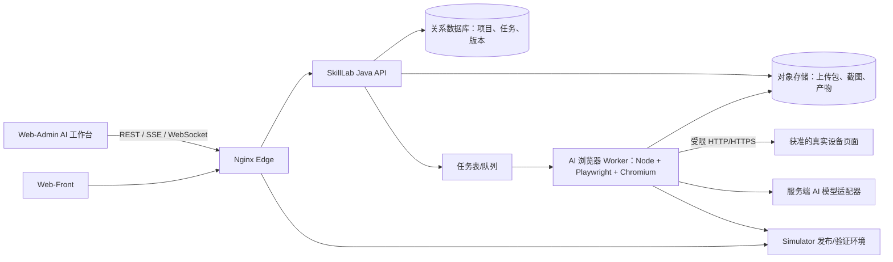

# SkillLab AI 设备模拟器制作工作台可行性方案

## 1. 目标与结论

在 SkillLab 管理端增加“AI 设备模拟器制作工作台”。管理员上传设备 Web 静态包，登记有授权的真实设备 Web 地址，在一个工作区中让 AI 协助浏览页面、记录网络接口和操作流程，并生成可审查、可回放、可发布的模拟器草稿。

**结论：技术上可行，建议分阶段建设。** AI 不应被当作一次性“输入 URL 后自动得到完整模拟器”的黑盒。可交付的产品闭环应是：

```text
静态包与设备登记 → 受控浏览和人工接管 → 接口/流程采集 → 生成模拟器草稿
  → 静态包回放验证 → 管理员审核 → 版本发布与回滚
```

一期重点是让制作过程线上化、可保存、可协作；AI 逐步接手重复的分析与配置生成。目标设备需由提交人拥有或获得明确授权。

## 2. 执行前项目基线

- `web-admin`、`web-front`、`web-simulator` 是 Vue 3 + Vite 前端；管理端的 Simulator 页面当前通过 iframe 加载独立 Simulator。
- Simulator demo 使用 `/device-demo/`、`/sim/` 根路径，Service Worker 注册在设备页目录下；它需要在安全上下文中运行。
- `skilllab-admin` 当前是 Spring Boot 2.7 / Java 8 的精简后端，已看到的 Controller 只有健康检查；当前仓库未呈现 AI、上传、任务持久化或管理端认证授权功能。
- `deploy/docker-compose.yml` 当前只有 Nginx edge 和 Java backend；三个前端构建产物通过只读卷提供服务。管理端 Nginx 已将请求体限制设为 32 MB，上传大包前需要调整或改用对象存储直传。
- 当前配置使用 `skilllab.xyz`、`skilllab-admin.xyz` 和 `sim.skilllab.xyz` 三个主机名。`sim.skilllab.xyz` 是 `skilllab.xyz` 的子域名，不需要再购买一个注册域名。建议继续使用独立 Simulator 源；把模拟器挪到管理端 `/simulator/` 路径会让不可信设备 JS 与管理端共享 origin，且现有根路径、Service Worker scope 需要改造。

以上描述方案编写前的仓库形态，不代表生产环境中不存在仓库外的认证、数据库或对象存储服务。

## 3. 用户工作区设计

新增管理端路由，例如 `/ai-workbench`，采用左右分栏。

| 区域 | 能力 |
| --- | --- |
| 项目栏 | 设备厂商/型号、静态包版本、设备地址、当前采集会话、草稿和发布版本 |
| 左侧指令与时间线 | 自然语言命令、AI 计划、用户确认、浏览器事件、网络接口采集结果、错误与重试记录 |
| 右侧远程浏览器 | 显示 Worker 中真实 Chromium 页面；管理员可手动点击、输入和接管，不依赖设备允许 iframe |
| 产物面板 | 页面/流程、接口目录、Mock 规则、Overlay 步骤、插件替代方案、差异预览和版本发布 |

支持的指令例子：

- “打开登录页，分析登录成功后进入设备列表的流程。”
- “刚才录像列表没有请求到，重新进入录像页并记录请求和响应。”
- “比较静态包的设备详情页和真实设备页面，列出缺失的接口。”
- “为已采集的录像查询流程生成 Mock 草稿，并运行回放验证。”

浏览器画面应由隔离 Worker 提供。MVP 可采用 WebSocket 传输压缩截图、鼠标/键盘事件和状态；后续并发或画质要求上升时再评估 WebRTC。指令事件和浏览器控制流分开：任务记录走 SSE，实时画面与输入走 WebSocket。

## 4. 推荐架构



### 4.1 组件职责

1. **Web-Admin**：项目管理、上传进度、命令交互、远程浏览器视图、草稿审阅和发布入口。不在浏览器端保存模型密钥或设备密码。
2. **SkillLab Java API**：沿用现有后端，增加用户身份/角色校验、项目与任务 API、文件元数据、审计日志、任务状态、产物版本和发布操作。耗时浏览任务不占用同步 HTTP 请求线程。
3. **关系数据库**：持久化项目、任务状态、设备访问授权、接口目录、工作流步骤、草稿版本和审核记录。当前仓库没有可见的数据库配置；上线前需确定复用现有数据库还是新增受支持的关系数据库。
4. **对象存储**：保存原始 ZIP、隔离后的静态包、采集截图和已发布产物。生产优先采用私有对象存储直传；MVP 可用受限的本地卷适配同一存储接口。
5. **AI 浏览器 Worker**：独立 Node 容器，运行固定版本的 Playwright/Chromium。负责浏览器会话、画面流、网络事件收集、AI 工具执行和草稿生成。容器不对公网暴露端口。
6. **模型适配器**：由 Worker 服务端调用模型，可替换供应商；将脱敏后的页面摘要、截图和接口样例按需发送。提供超时、重试、用量上限和可观测性。
7. **Simulator**：继续负责模拟器运行、Service Worker Mock、Overlay、插件替代和考试/练习运行。AI 产物先作为草稿，审核后才发布为新的设备版本。

### 4.2 任务与事件

任务状态建议使用：`CREATED`、`VALIDATING_PACKAGE`、`WAITING_FOR_BROWSER`、`BROWSING`、`NEEDS_USER`、`GENERATING_DRAFT`、`REPLAY_VALIDATION`、`READY_FOR_REVIEW`、`PUBLISHED`、`FAILED`、`CANCELLED`。

状态和文本事件由 Spring `SseEmitter` 推送；浏览器图像、鼠标和键盘经同源 WebSocket 通道传输。断线后可通过任务 ID 恢复事件。Worker 对任务采用租约和心跳，异常退出后任务可安全重试；“已执行真实设备写操作”的步骤不能自动重放。

## 5. 核心业务流程

### 5.1 建立设备项目并导入静态包

1. 管理员创建项目，填写厂商、型号、目标设备类型和备注。
2. 上传 ZIP；服务端校验扩展名、内容签名、文件数、压缩后大小和解压后大小，生成随机存储名，拒绝路径穿越、符号链接和 ZIP 炸弹。
3. 将文件解压到隔离工作目录，生成文件清单；识别入口 HTML、脚本、样式、API 前缀、外部依赖和根路径资源引用，产出兼容性报告。
4. 只做静态分析时禁用网络；需要预览包时，在无管理凭证、无宿主目录挂载、受控出网的沙箱浏览器中打开。
5. 静态包形成不可变的 `packageVersion`；后续 AI 修改均生成派生版本，保留原始包和差异。

### 5.2 连接真实设备并采集

1. 管理员登记目标 URL 和获准访问范围；HTTP 与 HTTPS 均允许，scheme 仅允许 `http` 或 `https`。
2. API 校验当前用户对设备项目的权限、目标主机/端口白名单和重定向目的地；Worker 网络策略只开放项目获批目标及必要资源域名。
3. Worker 创建一次性、隔离的浏览器上下文，默认不共享 Cookie、Local Storage 或浏览器缓存。
4. 登录优先由管理员在远程浏览器中手工完成。若后续支持保存凭证，凭证必须在独立密钥存储中加密并且不得进入模型上下文、截图、命令历史或应用日志。
5. AI 通过受限工具查看可访问性树/截图、导航、点击、填写非秘密字段、等待页面变化、读取响应和记录流程。用户可随时接管、暂停或终止。
6. 捕获请求方法、URL、状态、Content-Type、脱敏后的请求/响应样例、页面与触发步骤；按需保存正文，不默认长期保存完整流量。
7. 将采集结果整理为接口目录和流程步骤，标明“观察到/推断/待确认”置信度；管理员修正漏采页面后继续采集。

### 5.3 生成、验证、发布

1. AI 输出结构化草稿，不直接执行或发布任意模型生成的 JavaScript。
2. 由受版本控制的模板生成 Mock 配置、Overlay 步骤、接口映射和插件替代配置；每项可以人工编辑和查看差异。
3. 将静态包和草稿部署到 HTTPS 隔离测试环境，运行登录后页面、设备信息、录像查询/播放等已声明的流程。
4. 验证请求是否命中 Mock、关键字段是否满足 schema、Service Worker 是否控制正确页面、浏览器控制台是否存在错误、模拟器是否仍向真实设备发出意外请求。
5. 管理员通过后生成不可变发布版本，可灰度给练习/考试端使用；出现问题可回滚到上一版本。

## 6. 接口与数据模型建议

### 6.1 API 草案

| 方法 | 路径 | 用途 |
| --- | --- | --- |
| `POST` | `/api/ai/device-projects` | 创建设备项目 |
| `POST` | `/api/ai/device-projects/{id}/package-uploads` | 创建上传任务/获取受限直传地址 |
| `POST` | `/api/ai/device-projects/{id}/sessions` | 创建目标浏览会话 |
| `POST` | `/api/ai/sessions/{id}/commands` | 提交自然语言命令 |
| `GET` | `/api/ai/sessions/{id}/events` | SSE 任务时间线 |
| `WSS` | `/api/ai/sessions/{id}/browser` | 远程画面与人工输入；使用短期会话令牌 |
| `POST` | `/api/ai/sessions/{id}/approvals` | 确认或拒绝高风险动作 |
| `GET` | `/api/ai/device-projects/{id}/drafts/{version}` | 获取接口、流程和配置草稿 |
| `POST` | `/api/ai/device-projects/{id}/drafts/{version}/validate` | 运行隔离回放验证 |
| `POST` | `/api/ai/device-projects/{id}/releases` | 审核并发布版本 |

服务端对所有端点执行项目级鉴权。上传接口采用短期、单项目、单对象的上传授权；不能把 Worker 的内部地址或永久对象存储凭证返回给前端。

### 6.2 持久化对象

- `DeviceProject`：项目、设备型号、授权范围、所有者和状态。
- `PackageVersion`：原始包哈希、入口、文件清单、兼容性报告、存储键。
- `ExplorationSession`：提交人、获准目标、网络位置、浏览器版本、状态和过期时间。
- `TaskEvent`：用户命令、AI 计划、观察结果、用户接管/确认、错误和审计信息。
- `NetworkContract`：方法、规范化路径、参数/字段 schema、脱敏样例、触发页面/步骤、置信度和人工确认状态。
- `WorkflowDraft`：页面、动作步骤、前置条件、预期结果、是否有副作用及批准记录。
- `SimulationDraft` / `Release`：Mock、Overlay、桥接配置、媒体素材、静态包版本、验证报告和发布历史。

接口样例必须记录脱敏后的值和字段结构，不把密码、Cookie、Authorization、设备序列号或个人数据当作可默认保留的调试信息。

## 7. HTTP、Service Worker 与域名方案

### 7.1 真实设备 HTTP 地址

HTTP 设备地址可由 Worker 的浏览器直接访问；这与管理端页面本身是否 HTTPS 是两个不同的浏览器上下文。不要把 HTTP 设备页直接放进 HTTPS 管理端 iframe：混合内容策略可能阻止它。远程浏览器画面通过 HTTPS/WebSocket 回传，因此管理端不直接加载 HTTP 页面。

真实设备 HTTP 的凭证和流量没有 TLS 加密。优先使用设备支持的 HTTPS；无法升级时，把 Worker 放在可信内网或 VPN，限制可访问网段，并明确提示管理员当前连接不加密。Simulator 发布包仍应由 HTTPS 提供，因为 Service Worker 只在安全上下文工作（浏览器对 localhost 有开发例外）。

### 7.2 两个注册域名下的 Simulator

当前已用 `sim.skilllab.xyz` 作为独立 Simulator hostname。保留该隔离 origin，并可按设备或项目使用 `p-{project}.sim.skilllab.xyz` 子域名。这样仍只需拥有现有两个注册域名；子域名通过 DNS 配置，不是新增注册域名。若使用项目级子域名，需配置 wildcard DNS 与相应 TLS 证书（通常使用 DNS-01 签发通配符证书）。

独立 origin 有两点价值：一是 Service Worker 与被模拟页面保持同源；二是上传设备静态包中的可执行 JS 不与 Admin/Front 共用 origin。不要给模拟器或设备包设置覆盖父域的 Cookie。现有 Simulator CSP 需要继续只允许管理端和考试前台嵌入。

设备包如果全部使用相对资源路径，可以在每项目独立路径下托管；如果检测到以 `/` 开头的根路径资源，路径前缀托管可能破坏资源加载。生产建议为这类旧包分配项目级 Simulator 子域名，令其根路径仍落在本项目；兼容性扫描无法自动修正的硬编码绝对域名需显示为人工处理项。

## 8. 安全与权限设计

1. **目标地址与 SSRF**：仅允许管理员登记并批准的目标。scheme/端口受限，逐跳校验重定向，DNS 解析结果在连接时重新校验；禁止访问云元数据、宿主机、容器管理接口和未批准网段。内网设备属于显式允许项，按项目和端口做最小授权，而不是关闭内网限制。
2. **网络隔离**：Worker 不挂载 Docker socket、宿主机文件或其他项目数据；容器网络只允许 API 控制通道、模型服务和目标白名单。目标在内网且云端无法访问时，部署一个内网 Runner，通过出站 mTLS/短期任务拉取连接云端，不向互联网开内网入站端口。
3. **上传包隔离**：对 ZIP 做目录遍历、符号链接、压缩炸弹和资源耗尽防护；静态文件默认不信任。解压、预览和执行均在隔离环境完成，不在 Java API 容器或 Nginx 上运行包内代码。
4. **AI 工具边界**：不允许模型执行任意 Shell、任意 JS、任意 URL 或任意文件读写。只开放有 schema 的浏览器工具；每个动作检查目标源、超时、动作次数和任务范围。
5. **真实设备副作用**：默认只读探索。保存配置、删除、重启、恢复出厂、触发报警/继电器等动作必须暂停并要求管理员明确确认；确认内容、用户、时间和结果进入审计日志。对疑似写操作的 GET 接口也按副作用处理。
6. **凭证与敏感内容**：凭证不进 Prompt/事件日志；对表单密码、Cookie、Authorization、令牌和响应敏感字段做遮盖。浏览器录屏/截图可配置保留期限，支持立即清理会话数据。
7. **管理员鉴权**：当前仓库可见后端尚未展示完整登录和 RBAC。AI 工作台公开给管理员前，必须接入现有身份源或补齐认证、角色、项目权限、CSRF 防护和审计。
8. **会话与流媒体**：WebSocket 使用短期、单会话令牌并校验 Origin、用户和项目；Worker 端口不公网开放。用户离开或超时后关闭浏览器上下文并清除临时凭证。

## 9. 部署改造

保留现有 Nginx 单公网入口和 Admin/Front/Simulator 静态部署，在 Docker 网络内增加：

- `ai-worker`：Node + Playwright/Chromium，内网服务；MVP 限制并发，后续按队列横向扩展。
- 持久化数据库：项目、任务、状态和审核记录；若生产环境已有数据库，优先复用。
- 私有对象存储：上传包、版本包、截图和产物；MVP 可用受限卷，后续迁移对象存储。
- 可选 `on-prem-runner`：需要访问办公室/机房内设备时按站点部署，不允许其任意访问整个内网。

Nginx 增加或调整：

- 上传直传所需的受限上传授权和 CORS（仅对象存储需要跨源时配置）。
- SSE 关闭响应缓冲并设置合理的长连接超时与心跳。
- WebSocket Upgrade/Connection 转发，严格校验来源和短期令牌。
- 对静态包发布路由使用独立 Simulator hostname；扩展请求体限制只应用于上传路由，避免全站放大请求上限。

模型 API 密钥使用服务端 Secret，不放在 Compose 文件、前端构建变量或前端 bundle 中。日志中不记录访问令牌和请求正文。容器镜像固定依赖版本、定期更新 Chromium 和浏览器自动化库。

## 10. 分阶段实施与交付门槛

### 阶段 A：基础设施与安全地基

- 确定管理端身份源/RBAC、关系数据库、对象存储、模型供应商与数据留存规则。
- 建立设备 URL 授权、Worker 网络隔离、包上传沙箱、任务模型和审计。
- 交付：管理员能创建项目、上传包、登记被批准的 URL；拒绝未授权目标和不安全压缩包。

### 阶段 B：远程浏览器与人工采集

- 完成工作台左右分栏、隔离 Playwright 会话、画面回传、手动接管、HTTP/HTTPS 访问和请求/响应脱敏采集。
- 交付：管理员可登录真实设备、手动走流程、看到 API 时间线，并能重连、停止和删除会话。

### 阶段 C：AI 辅助探索与接口目录

- 增加受限浏览器工具、页面理解、自然语言任务拆解、漏采提示、接口归纳和流程草稿。
- 交付：AI 生成的每条接口和步骤都关联来源页面/事件，并可标记确认、修订或拒绝；副作用动作有审批。

### 阶段 D：Mock/Overlay 生成和回放

- 定义版本化 schema 与代码模板，生成 Mock、Overlay、插件替代和设备包适配配置；在 HTTPS 隔离环境回放并输出结果。
- 交付：生成草稿不直接覆盖已发布版；关键流程验证失败时不允许发布；支持版本差异、审批和回滚。

### 阶段 E：规模化与内网设备

- 加入任务队列/Worker 横向扩展、多个 Runner 站点、成本与并发限额、保留策略、异常恢复和运维面板。
- 交付：Worker 崩溃/断线可恢复；每个 Runner 只能到达获批目标；可追踪模型用量、任务耗时与失败原因。

## 11. 验收标准

- 管理员可在 Web-Admin 完成新建项目、上传、分析、连接真实页面和会话恢复，不需要本地安装爬虫工具。
- HTTP 设备页在远程浏览器中可访问；管理端不直接 iframe 加载 HTTP；对不加密连接显示明确提示。
- 对一次完整操作流程，接口目录包含触发页面、方法、路径、状态、脱敏样例和确认状态；秘密不出现在 Prompt、事件日志、下载产物或发布包。
- 用户可中途接管；保存/删除/重启等高影响操作在明确批准前不会由 AI 执行。
- 上传的原始包保留不变；AI 产物可 diff、验证、审批、发布和回滚。
- Simulator 发布环境使用 HTTPS；Service Worker 在正确的设备页面 scope 下工作；不同项目的缓存和版本互不污染。
- Worker 无公网入站端口；未经批准的 URL、重定向目标、私网地址和上传包访问均被拒绝或按项目规则限制。
- 本地测试设备、真实内网设备和公网设备三类网络环境各有一套端到端验证用例。

## 12. 主要风险与未决项

| 项目 | 风险/影响 | 开工前需要确定 |
| --- | --- | --- |
| 设备可达性 | 云端服务器可能无法访问私网设备 | 是否部署内网 Runner，覆盖哪些网络区域 |
| 静态包差异 | 根路径、硬编码设备 IP、插件、加密/混淆脚本会影响自动加工 | 收集代表性设备包做兼容性试验 |
| 真实设备副作用 | 页面按钮可能改变配置或造成设备中断 | 明确默认只读策略和确认分级 |
| 数据与合规 | 流量、截图、设备信息可能包含敏感数据 | 模型服务位置、脱敏规则和留存期限 |
| 文件规模 | 32 MB Nginx 限制可能不适合大型包 | 统计典型包大小并决定直传、配额和解压上限 |
| 域名与证书 | 项目级子域名需要 wildcard DNS/TLS 自动化 | DNS 提供商是否支持 DNS-01 与通配符解析 |
| 后端基线 | 可见代码尚无认证和持久化层 | 复用已有生产能力或将其纳入一期范围 |
| 成本与并发 | 浏览器会话与模型调用都随并发增长 | 设备数量、并发会话、模型供应商和预算上限 |

建议先选 2–3 个具有代表性的设备包做阶段 A/B 的技术验证：包括一个普通 HTTP 页面、一个登录后 SPA 页面、一个有插件/回放的页面。验证完资源路径、登录、网络捕获、服务 Worker 和内网连通后，再冻结统一的设备配置 schema。

## 13. 技术参考

- [Playwright 页面导航与交互](https://playwright.dev/docs/pages)
- [Playwright 网络请求/响应事件](https://playwright.dev/docs/network)
- [Playwright BrowserContext 隔离与网络监听](https://playwright.dev/docs/api/class-browsercontext)
- [MDN Service Worker API 安全上下文要求](https://developer.mozilla.org/en-US/docs/Web/API/Service_Worker_API)
- [MDN 混合内容规则](https://developer.mozilla.org/en-US/docs/Web/Security/Defenses/Mixed_content)
- [OWASP SSRF Prevention Cheat Sheet](https://cheatsheetseries.owasp.org/cheatsheets/Server_Side_Request_Forgery_Prevention_Cheat_Sheet.html)
- [OWASP File Upload Cheat Sheet](https://cheatsheetseries.owasp.org/cheatsheets/File_Upload_Cheat_Sheet.html)
- [Spring Framework 5.3 SSE / SseEmitter](https://docs.spring.io/spring-framework/docs/5.3.x/reference/html/web.html#mvc-ann-async)

## 14. 首次执行进度

已实现第一版可运行闭环的代码骨架，具体启动方式和限制见 docs/ai-workbench-mvp-runbook.md：

- 管理端新增 AI 工作台，支持输入部署密钥、新建设备项目、上传 ZIP、启动设备浏览会话、远程点击/输入、查看请求列表和批准/拒绝非只读请求。
- Java 后端新增受部署密钥保护的 AI API、H2 项目/包/会话元数据、ZIP 路径与解压大小检查、目标 origin 白名单，以及与 Worker 的内部调用。
- 新增 Playwright Worker：隔离浏览器上下文、HTTP/HTTPS 页面导航、截图、网络事件、敏感 query 脱敏、非只读及疑似配置修改 GET 请求逐次审批；WebSocket 默认阻止，需单独配置 origin 后才允许连接；支持服务端配置的兼容 Chat Completions 端点执行单步 AI 浏览动作，并自动清理空闲会话。
- 新增持久化接口草稿：按观察到的请求归并方法/路径、状态码、请求体存在性与脱敏 JSON 响应样例，生成需要人工审查的 Mock schema，并可在工作台预览和下载。
- 新增 Compose override 和部署环境变量示例；现有 docker-compose.yml 未作为本次方案执行的修改目标。

当前版本属于单机 MVP，不代表完整生产版本。项目执行数据暂用 H2 文件库和本地卷；浏览器会话、网络事件和待审批请求暂存在 Worker 内存中；管理鉴权是供 MVP 启动的共享访问密钥，不是多用户身份/RBAC。已生成的 Mock schema 仍是下载/审阅草稿；设备包尚未解压部署到 Simulator、Overlay 未生成，也未实现回放、版本发布和回滚。Worker 网络层 egress ACL 尚未配置，因此在开放公网前必须先部署网络层访问限制；应用层 origin 白名单不能代替网络隔离。

首次实现阶段已通过 web-admin 生产构建、Java 跳过测试的 Maven 打包、Worker JavaScript 语法检查和 Docker Compose 配置解析；没有运行自动化测试。部署前仍应按团队环境确认数据库、对象存储、身份源、AI 模型端点、DNS/证书与内网 Worker 位置。
